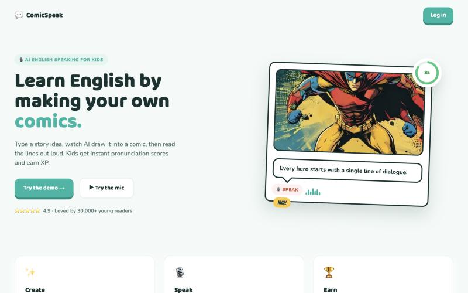
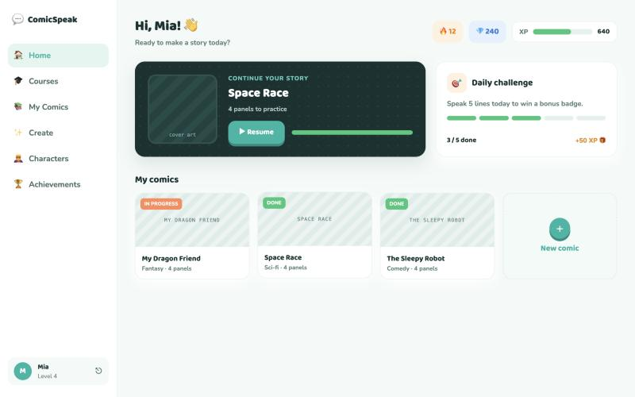
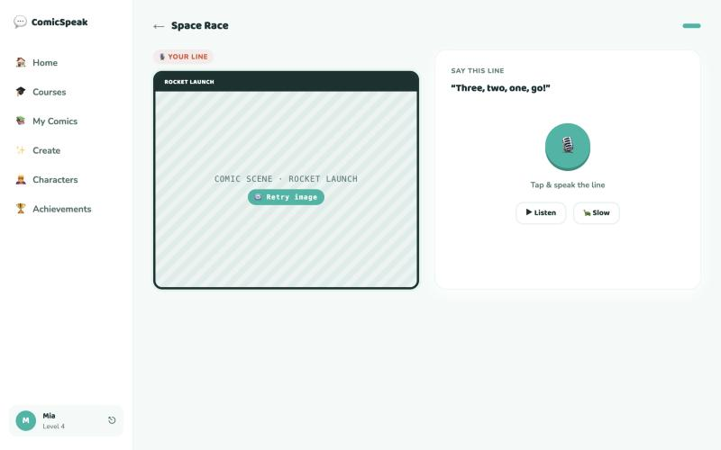
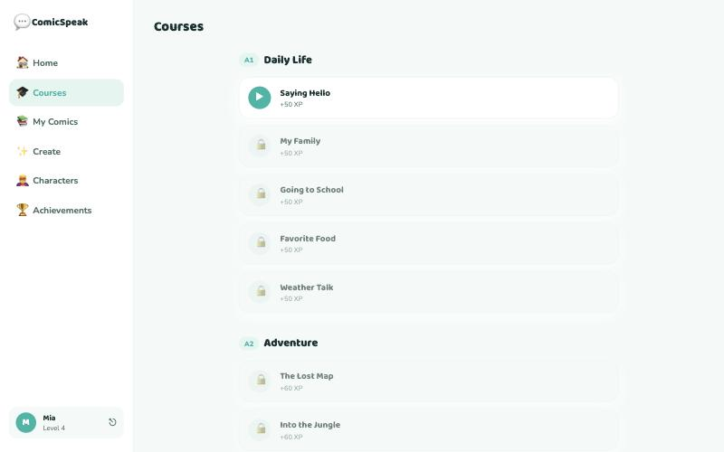

# ComicSpeak AI 💬

A web platform where kids learn to **speak English by making their own comics**. A child types a story idea, AI writes and draws a comic, and then the child reads the characters' lines out loud and gets an instant, word-by-word pronunciation score — with XP, streaks and badges to keep them coming back.



| Student dashboard | Reading and speaking |
|---|---|
|  |  |

| Courses |
|---|
|  |

<sub>Screenshots from a local run with demo data; comic art shows placeholders because image generation was not configured.</sub>

## Features

- ✨ **AI comic generation** — from a topic, art style and length, an LLM writes the story and dialogue, and an image model draws every panel
- 🎙️ **Speech practice** — the child reads a line aloud; speech is transcribed with Whisper and scored word by word, with missing words highlighted
- 🦸 **Characters** — reusable characters (superhero, robot, animal, fantasy, historical) that appear in new comics
- 📚 **Courses** — lessons grouped by level (A1 Daily Life, A2 Adventure); each lesson unlocks the next
- 🏆 **Gamification** — XP, levels, daily streaks, a daily challenge and achievements
- 👩‍🏫 **Teacher panel** — teachers manage their students, follow progress and reset passwords

## How it works

```
topic ─▶ LLM (Groq or local Ollama) ─▶ story + dialogue per panel
                                            │
                                            ▼
                       image model (fal.ai FLUX, or free Pollinations) ─▶ comic panels

child reads a line ─▶ microphone (MediaRecorder) ─▶ Whisper (Groq or local mlx-whisper)
                                            │
                                            ▼
                       word-by-word match against the line ─▶ score, missing words, XP
```

Every AI piece has a free or local fallback, so the project runs without paid API keys: Ollama instead of Groq for text, Pollinations instead of fal.ai for images, and a local Whisper service instead of Groq for speech.

## Tech stack

| Part | Stack |
|---|---|
| Frontend | Next.js (App Router), React, TypeScript, Tailwind CSS |
| Backend | NestJS, Prisma, PostgreSQL, JWT auth in an HTTP-only cookie |
| AI | Groq / Ollama (LLM), fal.ai FLUX / Pollinations (images), Whisper via Groq or `mlx-whisper` |
| Speech service | Python, FastAPI, `mlx-whisper` ([`whisper-service/`](whisper-service)) |

## Project structure

```
app/             Next.js pages: landing, auth, dashboard, create, characters,
                 reading, courses, achievements, teacher admin
components/      UI components
lib/             API client, pronunciation scoring
backend/         NestJS API: auth, comics, characters, speech, courses,
                 teachers, admin; Prisma schema and seeds
whisper-service/ local speech-to-text service
docs/            design system and screen spec (design-handoff.md)
```

## Getting started

On macOS, [`start.sh`](start.sh) starts everything at once (Postgres, Ollama, the Whisper service, backend and frontend) and [`stop.sh`](stop.sh) stops it. Step by step:

**1. Database**

```bash
docker compose up -d postgres
```

**2. Backend** (port 3001)

```bash
cd backend
cp .env.example .env          # fill in the values you need
npm install
npx prisma migrate deploy
npx prisma db seed            # demo student "Mia" / demo1234 and sample comics
set -a; source .env; set +a   # NestJS does not read .env by itself
npx ts-node prisma/seed-courses.ts
npm run dev
```

**3. Frontend** (port 3000)

```bash
npm install
npm run dev
```

Open http://localhost:3000 and log in as the demo student.

**Optional: local speech recognition** (Apple Silicon) — if `GROQ_API_KEY` is not set, the backend sends audio to the local Whisper service:

```bash
cd whisper-service
pip install -r requirements.txt
uvicorn app:app --port 8001
```
